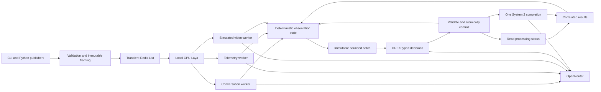

# Technical architecture

One Python 3.14 asyncio process owns the queue consumer, CPU routing executor, independent reducer workers, state lock, gate scheduler, and operation tasks. Redis is a dedicated transient local process. OpenRouter is the hosted inference boundary.

## Boundaries and dependencies

- Pydantic validates contracts; immutable canonical JSON bytes prevent nested mutation.
- `redis.asyncio` handles Lua admission/ownership and `BLPOP`.
- Laya/PyTorch run only on CPU in one serial executor, with no automatic checkpoint selection.
- `httpx` handles both OpenRouter completions and typed `/systemone` calls. There is no provider framework.
- A short state lock covers atomic groups, presentation, dispositions, and operation reservations. Network/model work runs outside it.
- Runtime-created IDs and correlation prevent model output from expanding authority.
- pytest/pytest-asyncio cover contracts, fault boundaries, concurrency, and real Redis integration.

The package is [src/signal_reducers](../../src/signal_reducers). Shared contracts, transport, router, reducers, providers, state, gate, runtime, CLI, and demo are explicit modules.

## Inference

Reducers and System 2 request strict JSON schemas. DREX takes `state` and closed `questions`; generated JSON-plan parameters are not sent. System 2 receives immutable captured context, selected effort, and `exclude=true`, without token-budget fields. Responses are locally validated; neither reducers nor System 2 can change lifecycle state.

Laya inputs include metadata, bounded preview, prior same-source outcomes, and registry definitions supplied through routing questions. The tokenizer preflight rejects truncation and collapsed options. Model/checkpoint/prompt/registry hashes accompany qualification. The routing corpus is bundled package data. Downloads use the standard Hugging Face user cache; release artifacts contain no model weights.

[OpenRouter decisions](https://openrouter.ai/docs/guides/community/typesafe-sdk), [DREX model](https://openrouter.ai/nace-ai/drex-v1.5), [structured outputs](https://openrouter.ai/docs/guides/features/structured-outputs), [reasoning controls](https://openrouter.ai/docs/guides/best-practices/reasoning-tokens), and [Laya](https://github.com/NandhaKishorM/laya) describe advertised mechanisms; actual P0 quality requires measurements.
